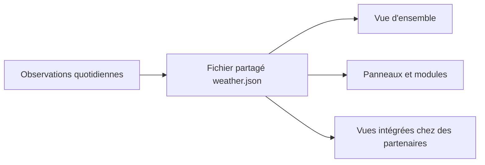

# NeoMundi — Météo des IA

### Une observation. Tous les formats.

**Mesurer une fois. Publier partout.**

*Un même jeu de données d'observation pour une vue complète et des modules intégrables.*

 · 

  

**[Observatoire NeoMundi](https://neomundi.org/)** · **[Station d'observation actuelle](https://station.neomundi.org/)**

**[Découvrir les formats](#formats-de-publication)** · **[Architecture](#architecture)** · **[Intégration](#intégrer-les-modules)**

---

## Une source. Plusieurs manières d'observer.

Ce dépôt documente le **kit historique de publication et d'intégration de la Météo des IA**. Il ne doit pas être confondu avec l'infrastructure actuelle de la Station. Pour suivre les programmes de l'Observatoire et les observations publiées, consultez [neomundi.org](https://neomundi.org/) et [station.neomundi.org](https://station.neomundi.org/).

**Ce projet ne produit pas de classement.** Les couleurs représentent des conditions observées, pas des notes concurrentielles, des preuves de vérité ou des certifications de modèles.

## Ce que permet le kit

Le kit réunit plusieurs présentations d'un même jeu de données de mesures comportementales d'IA : une vue d'ensemble, des panneaux compacts, une barre horizontale, une barre latérale et des modules propres à un système observé.

L'approche est simple : **une seule publication des données, plusieurs surfaces de lecture**. Les formats sont conçus pour réutiliser les mêmes données, les mêmes traductions et les mêmes thèmes visuels.

> **La couleur décrit le signal observé. Le nom du modèle sert à identifier le système.** Les informations détaillées restent accessibles dans la vue complète.

## Formats de publication

| Format | Fichier | Usage |
| --- | --- | --- |
| Vue complète | `index.html` | Ensemble des systèmes et accès aux détails |
| Panneau principal | `core-panel.html` | Présentation compacte d'un sous-ensemble |
| Module synthétique | `widget.html` | Condition globale dans un petit espace |
| Barre horizontale | `topbar.html` | Intégration dans un en-tête |
| Barre latérale | `sidebar.html` | Intégration dans une colonne |
| Module individuel | `provider-widget.html` | Présentation d'un système via un paramètre |
| Galerie d'intégration | `embed-demo.html` | Formats, thèmes et langues disponibles |
| Exemple autonome | `demo.html` | Aperçu avec données intégrées |

Le README anglais conserve les détails techniques de chaque format et de ses paramètres.

## Architecture

Le projet sépare quatre responsabilités.

| Couche | Référence dans le dépôt | Fonction |
| --- | --- | --- |
| Données | `weather.json` | Source commune des observations publiées |
| Identification | `config/panel.yml` | Définition des systèmes et libellés publics |
| Traductions | `i18n/*.json` | Contenus linguistiques des interfaces |
| Présentation | `styles/` et composants HTML | Mise en page, thèmes et modules |

Le pipeline historique agrège des observations quotidiennes dans `weather.json` et ses archives. Les différents modules lisent cette source commune via `scripts/weather-data.js`.

Les libellés de conditions sont séparés des données : les identifiants comme `clear`, `variable` et `disrupted` sont ensuite traduits par les interfaces.

## Langues et personnalisation

Les traductions de l'interface sont prévues dans cinq fichiers : `en.json`, `fr.json`, `de.json`, `es.json` et `it.json`.

Les thèmes sont définis dans `styles/themes.css`. Les liens institutionnels et de navigation historiques sont centralisés dans `config/wording.json`, plutôt que dispersés dans chaque module.

**Attention à la distinction :** ces langues concernent l'interface de publication. Elles ne signifient pas que chaque document technique du dépôt a été traduit.

## Intégrer les modules

Le kit a été conçu pour l'intégration de pages et de modules HTML à partir d'URL absolues accessibles au navigateur. Les fichiers de référence comprennent :

- `index.html` pour la vue complète ;
- `topbar.html`, `sidebar.html` et `provider-widget.html` pour des intégrations ciblées ;
- `embed-demo.html` pour parcourir les variantes ;
- `config/wording.json` pour les liens ;
- `QUICKSTART.md` et `METHODOLOGY_THRESHOLDS.md` pour les instructions et les règles de mesure historiques.

Pour la syntaxe complète des paramètres, les procédures de test et les détails de déploiement, consultez les [sections techniques du README anglais](README.md#embedding--absolute-urls-required). Cette page française présente le projet et son architecture ; elle n'est pas une traduction intégrale des procédures historiques.

## Frontière de mesure

Les états affichés sont issus d'observations effectuées dans des conditions définies. Ils ne constituent pas une appréciation générale du modèle, un verdict sur une réponse individuelle ni une preuve de conformité ou de sécurité.

Le dépôt conserve l'historique des choix d'identification publique et des méthodes d'agrégation : leur portée doit être appréciée à partir des fichiers et des dates qui les documentent.

## Poursuivre l'exploration

| Votre objectif | Accès |
| --- | --- |
| Suivre l'Observatoire | [NeoMundi.org](https://neomundi.org/) |
| Consulter les observations actuelles | [Station NeoMundi](https://station.neomundi.org/) |
| Comprendre le cadre expérimental | [Validation métrologique](https://github.com/neomundi-io/neomundi-metrology-validation) |
| Examiner les pilotes et leurs preuves | [Cas d'usage](https://github.com/neomundi-io/neomundi-use-cases) |
| Explorer la documentation historique complète du kit | [README technique en anglais](README.md) |

---

**NeoMundi — des observations documentées, pas des verdicts universels.**
